# Rediseño «Aventura»: antes y después, y qué se verificó

Rama `rediseno-aventura` (13 tareas del plan `docs/superpowers/plans/2026-10-30-rediseno-visual-aventura.md`). Capturas en `capturas/` (390×740; «antes» es `master` sin tocar, «después» es la rama, en noche y en día).

## Antes / después por pantalla

| Pantalla | Antes | Después (noche) | Después (día) |
|---|---|---|---|
| Menú | 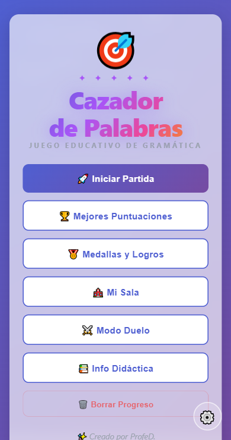 | 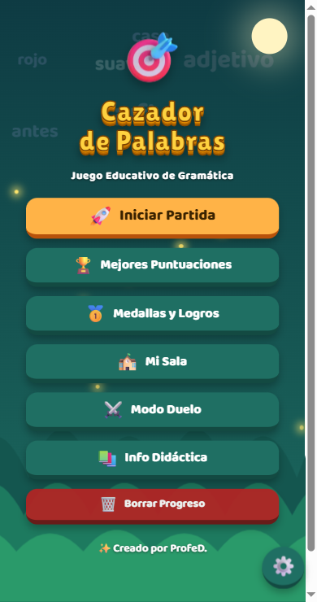 | 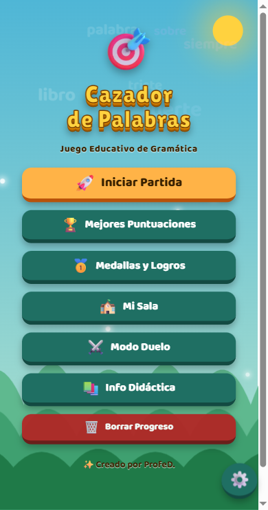 |
| Categorías | 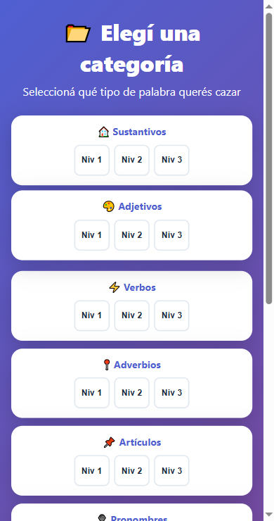 | 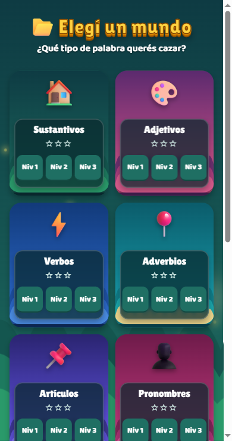 | 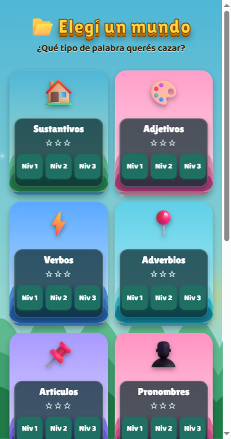 |
| Previa del nivel | 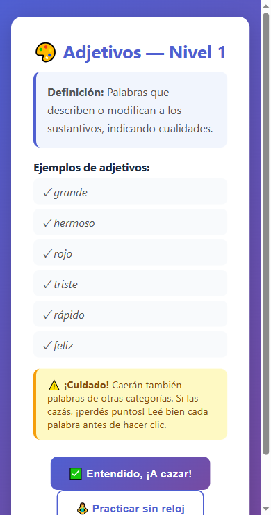 | 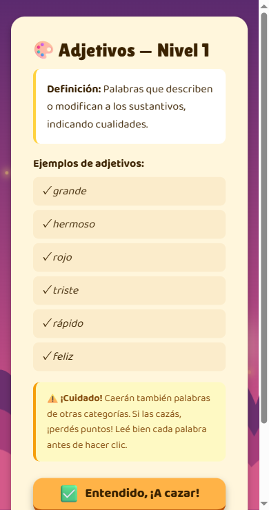 | 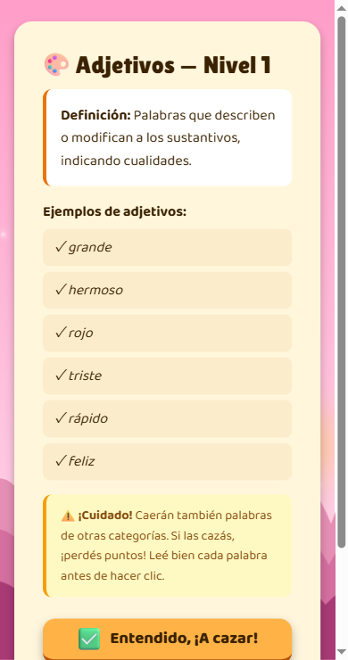 |
| Partida | 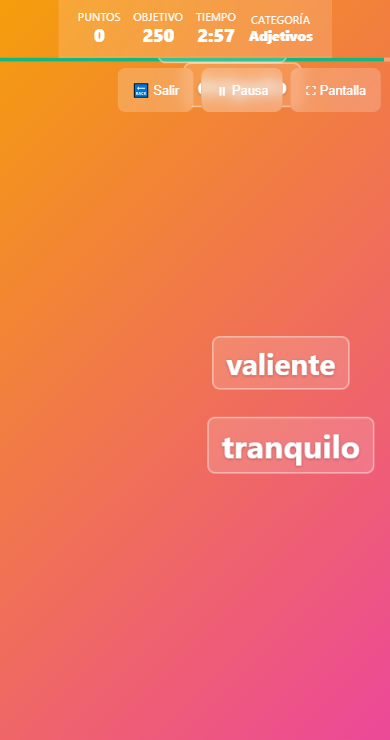 | 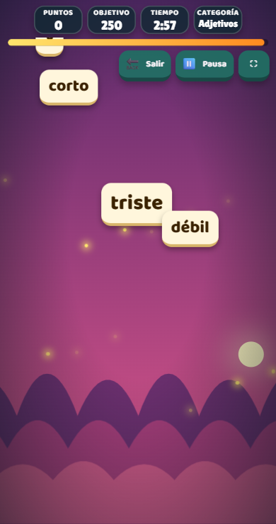 | 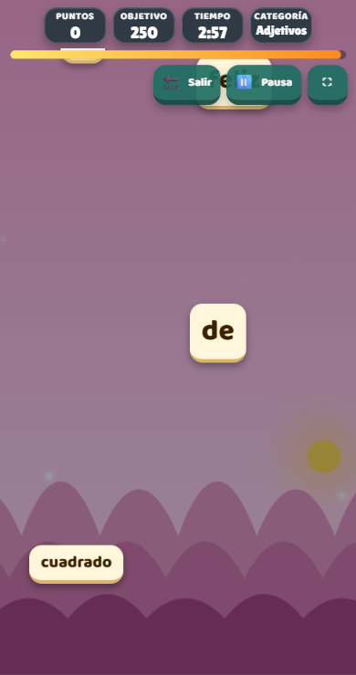 |
| Pantalla final | 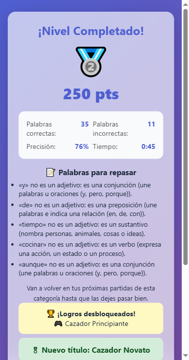 | 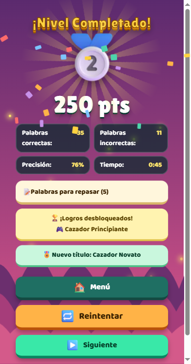 | 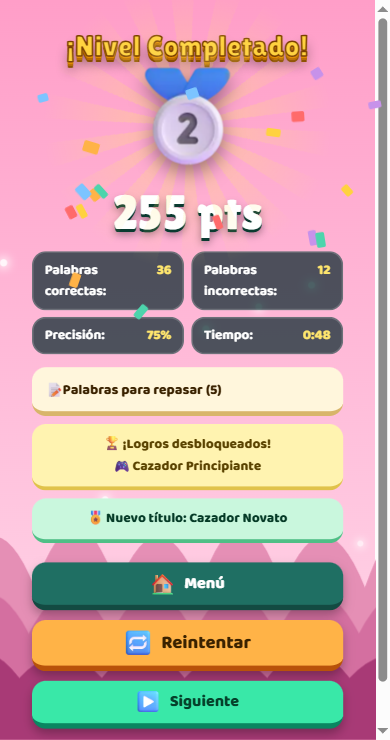 |
| Ajustes | 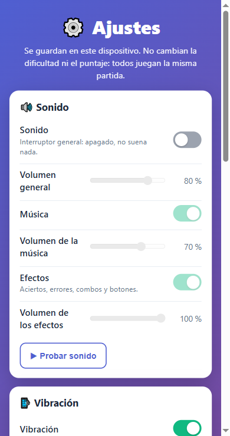 | 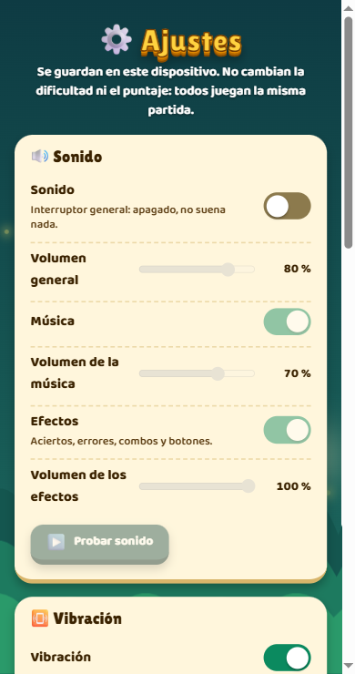 | 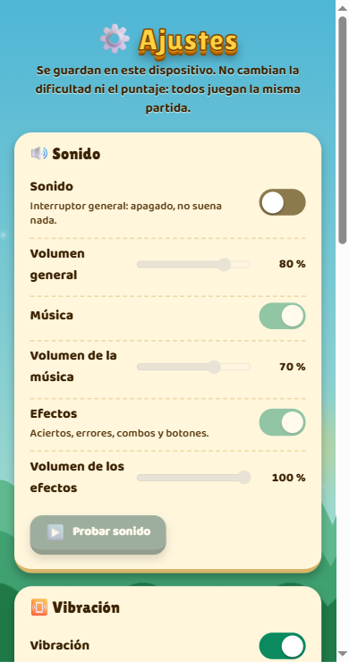 |

Las otras nueve pantallas (medallas, ranking, info, sala docente, resultados de sala, los cuatro del duelo) y los diálogos/avisos pasaron al mismo lenguaje; no tienen par antes/después acá porque no se capturaron con datos reales (ver «No verificado»).

## Cifras

| | Antes | Después |
|---|---|---|
| JS | 192 kB | 200 kB (gzip 63 kB) |
| CSS | 38 kB | 51 kB (gzip 11 kB) |
| Emojis (87, Fluent 3D a 128 px) | del sistema | 158 kB (presupuesto 250) |
| Tipografías (Lilita One + Baloo 2, latin) | del sistema | 43 kB (presupuesto 90) |
| Tests | 251 | 468 |
| Precache del service worker | — | 98 archivos, caché `cdp-9967989e0d` (se resella sola) |

## Verificado

- **Sin internet** (build real, service worker instalado, servidor apagado): carga el menú con paisaje, fuentes (Lilita One y Baloo 2) y 9 emojis; se abren las nueve categorías y arranca una partida de Verbos; 0 pedidos fallidos.
- **Rendimiento** (build, Chrome con la CPU ×4 emulada, nivel 3 con 12-14 palabras, 6 s): 56 fps en noche, día y «reducir movimiento»; 58 fps sin limitar; peor fotograma 18 ms.
- **Contraste, medido por tests** (no por apreciación): texto de botones, placas, palabras, combos, interruptores, superficies de las 15 pantallas, y las 10 paletas × noche y día (texto sobre placas ≥ 4,5:1; texto suelto sobre el cielo de día ≥ 4,5:1; colinas ≥ 3:1; palabra crema ≥ 3:1 contra el cielo atenuado de la partida).
- **Jugado de verdad en el navegador**: menú (1280, 390 y 360 px; noche, día, alto contraste, reducir movimiento), categorías (1280/390/360), previa, partida completa en tres tamaños y con «Muy grande», pantalla final con medalla de plata y sin medalla, ajustes, info, diálogos; «Auto» siguiendo al sistema en vivo.
- **Revisión final de la rama por un revisor independiente** (sin defectos críticos). Dos hallazgos importantes corregidos, cada uno con un test que primero falló: (1) con el tema «Auto», al cambiar el sistema entre claro y oscuro en vivo el texto cambiaba pero el paisaje no (texto marrón sobre cielo de noche); ahora se rehace y está comprobado en el navegador; (2) el aviso del lobby del duelo mostraba como imagen un emoji del nombre del rival; ahora está en zona protegida y un test barre todo `src` buscando elementos donde se escribe un nombre de jugador.
- **Tres defectos que el rediseño sacó a la luz y quedaron corregidos con test**: el menú no podía scrollear en pantallas bajas; el combo, los botones naranja y verdes de la maqueta y varias superficies daban menos de 4,5:1; con alto contraste la palabra marrón quedaba sobre fondo oscuro.

## No verificado (decirlo es parte de la entrega)

- **Duelo con dos jugadores y servidor real**: las cuatro pantallas se vieron con datos de relleno y fichas inventadas; no se jugó un duelo.
- **Sala docente, resultados de sala, ranking y medallas con datos reales**: solo se vieron vacíos o con datos de relleno.
- **Las diez pantallas sin maqueta en 1280×720 y 360×640, en día, con alto contraste y con reducir movimiento**: se revisaron en 390×740 de noche (algunas también de día). El resto se apoya en los tests de contraste y en las reglas CSS compartidas.
- **Dispositivos reales**: ningún celular ni tablet, ni Safari/iOS (hay `color-mix` con valor de respaldo, `backdrop-filter` y webp, que no se probaron fuera de Chrome). Los fps son de CPU emulada, no de un equipo viejo.
- **Sonido y vibración**: el juego se probó siempre silenciado; la capa de ajustes de sonido no cambió en este rediseño.

## Cómo agregar o cambiar un mundo

Un mundo es un dato en `src/data/mundos.ts`: dos paletas (`noche` y `dia`) con cielo alto, cielo bajo, tres colinas, acento y astro. Para cambiar un paisaje solo se editan esos colores; los tests de `src/data/mundos.test.ts` miden el contraste de cada combinación y fallan si algo deja de leerse. El dibujo de las capas está en `src/ui/paisaje.ts` y se aplica a cada pantalla con un `.fondo-mundo` (ver `src/ui/fondoMundo.ts`). Para sumar un mundo con otro dibujo (montañas, bosque, playa) basta con agregar un tipo de capa a `montarPaisaje` y elegirlo desde el dato del mundo: ninguna pantalla se toca.
